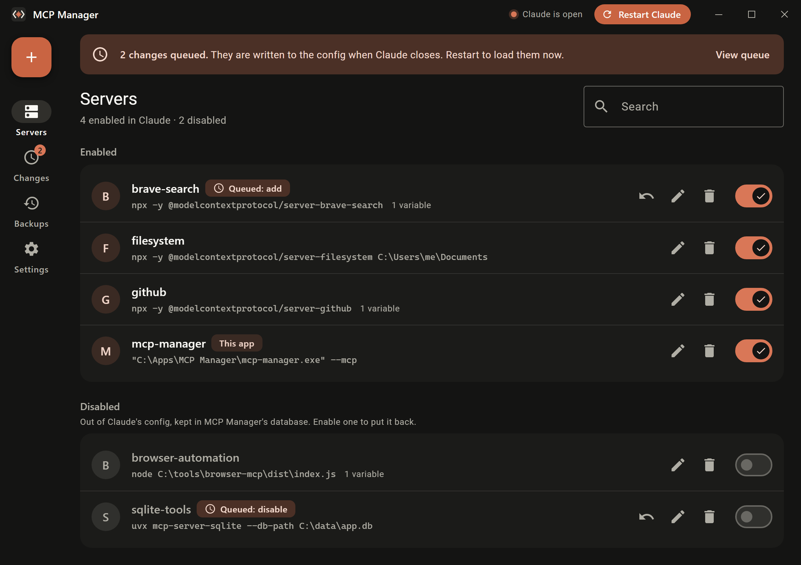

<p align="center">
  
</p>

<h1 align="center">MCP Manager</h1>

<p align="center">
  <b>A manager for Claude Desktop's MCP servers.</b>
</p>

<p align="center">
  <a href="../../releases/latest"></a>
  <a href="../../releases"></a>
  <a href="LICENSE"></a>
  
  
</p>

<p align="center">
  <b>English</b> · <a href="README.pt-BR.md">Português (Brasil)</a>
</p>

<p align="center">
  
</p>

---

MCP Manager is a free, open-source Windows app that adds, edits, disables and removes Claude
Desktop's MCP servers, from a window or from Claude's own chat. Every change made while Claude is
open waits in a queue and is written to `claude_desktop_config.json` when Claude closes; **Restart
Claude** closes it, applies the queue and opens it again. It also keeps disabled servers so you can
turn them back on, backs up the config before every write, waits in the tray, one click away, and
updates itself.

It runs on Windows (x64), in English and Brazilian Portuguese, and works with both ways Claude
Desktop is installed: the MSIX package and the older installer in `%LOCALAPPDATA%\AnthropicClaude`.
It is for anyone who sets up MCP servers in Claude Desktop and would rather not edit the JSON by hand
or time Claude's restart around it. It changes Claude Desktop's config only: the Claude Code CLI's
`~/.claude.json` is out of scope, and so are URL-only remote servers, which that config does not take.

## Highlights

- **Nothing changes while Claude is open.** Claude Desktop rewrites its own config while it runs, so
  every change made with Claude open goes into a queue. The queue is written once Claude's last
  process exits; **Restart Claude** closes it, applies the queue and opens it again.
- **Disabling does not delete.** A disabled server leaves the config and is kept in MCP Manager's
  database with its command, arguments, environment variables and any other field. Enabling it puts
  the same entry back.
- **Also from the chat.** The app is an MCP server too: registered with one click, it lets Claude
  list, add, edit, disable and remove servers. Through it, environment values reach the chat as `***`
  unless the agent asks for them.
- **A backup before every write.** `claude_desktop_config.json` is copied before each write and when
  the app opens, if the config changed; the 100 newest copies are kept, and any of them can be
  restored. Only `mcpServers` is touched: `preferences` and every other key are written back as read.
- **Finds the config from Claude's executable.** The path comes from the running `Claude.exe` or from
  the package registered in Windows: `%LOCALAPPDATA%\Claude-Data\<package>\` for MSIX,
  `%APPDATA%\Claude\` for the older installer.
- **Updates itself, and nothing else goes online.** The start screen names the versions not installed
  yet; one click in the Changelog downloads the new exe, checks its signature and restarts the app,
  even while Claude runs its MCP. That check, a request to this repository's latest release that Settings can turn off,
  is the only network request MCP Manager makes.

---

## Install

Download `mcp-manager.exe` from the [latest release](../../releases/latest), put it in a folder of its
own, such as `%LOCALAPPDATA%\Programs\MCP Manager\`, and double-click it. There is no installer: the
exe is the whole app, and later versions replace it in place from the Changelog screen. On the first
run, the **First steps** card in Servers registers the app's MCP in Claude, turns on starting with
Windows and creates the Start menu shortcut.

> [!IMPORTANT]
> The exe is not code-signed: Windows may show "Windows protected your PC" the first time. Check the
> download against `SHA256SUMS.txt` on the release page, then choose **More info** and **Run anyway**.

> [!NOTE]
> The exe's path is written into Claude's config when the app's MCP is registered, and into the
> start-with-Windows entry, so pick the folder before the first run. If you move the file later,
> Settings shows "Points to another executable" with an **Update the path** button; turn **Start with
> Windows** off and on again to fix the other entry.

<details>
<summary><b>Verify your download</b> — check the exe against the published hash</summary>

```powershell
(Get-FileHash .\mcp-manager.exe -Algorithm SHA256).Hash
```

The result must match the `mcp-manager.exe` line of `SHA256SUMS.txt`, ignoring letter case. The
in-app update does more: it checks the new exe's signature against the key built into the app, and
refuses a file signed for any other version.

</details>

<details>
<summary><b>Build from source</b> — prerequisites, development and test variables</summary>

You need Windows x64 with the
[WebView2 Runtime](https://developer.microsoft.com/microsoft-edge/webview2/) (it ships with Windows 11
and up-to-date Windows 10), Rust 1.89 or newer with the MSVC toolchain and Visual Studio Build Tools,
and Node.js 20.19+, 22.12+ or 24+.

```powershell
npm install
npm run app:build
npm run app:dev
npm run dev
npm run check
cd src-tauri; cargo test
```

`npm run app:build` writes `src-tauri\target\release\mcp-manager.exe`. `npm run app:dev` opens the app
with hot reload. `npm run dev` serves only the interface in a browser, at `http://localhost:1420`,
with sample data; `?hero` opens the state of the screenshot above, `?lang=en-US` or `?lang=pt-BR`
picks the language, and `?noupdate` hides the sample update.

| Variable | Effect |
|---|---|
| `MCP_MANAGER_HOME` | Data folder instead of `%USERPROFILE%\.mcp-manager` |
| `MCP_MANAGER_CONFIG` | Config used instead of the detected one |
| `MCP_MANAGER_FAKE_CLAUDE` | `1` pretends Claude is open, `0` closed |
| `MCP_MANAGER_NO_WATCHER` | Starts neither the watcher nor the tray app |
| `MCP_MANAGER_UPDATE_FEED` | Update feed URL instead of the latest release's `latest.json` |

</details>

<details>
<summary><b>Releasing a version</b> — changelog, version bump, tag and the release workflow</summary>

Every change adds its entries under `## [Unreleased]` in [CHANGELOG.md](CHANGELOG.md) and in
`locales/changelog/pt-BR.md`. To release:

```powershell
powershell -ExecutionPolicy Bypass -File tools\version.ps1 -Version 0.2.0 -Push
```

The script sets the version in `package.json`, `package-lock.json`, `tauri.conf.json`, `Cargo.toml`
and `Cargo.lock`, turns Unreleased into `[0.2.0]` with today's date in both changelogs, commits, tags
`v0.2.0` and pushes. The tag starts `.github/workflows/release.yml`, which tests, builds, signs the
exe with the repository secrets `TAURI_SIGNING_PRIVATE_KEY` and `TAURI_SIGNING_PRIVATE_KEY_PASSWORD`,
and drafts the release with the exe, its signature, `latest.json` and `SHA256SUMS.txt`. Installed
apps see the version once the draft is published.

</details>

---

## The window

Open it from the tray icon or the Start menu shortcut. The **+** button adds a server. The window
draws its own title bar: it shows whether Claude is open and, while changes are queued, the
**Restart Claude** button, with a banner below that explains the queue.

| Screen | What it does |
|---|---|
| **Servers** | The enabled and the disabled servers, with a switch to turn each one on or off, edit, remove, and undo the last queued change. The editor takes JSON pasted from a README and fills in the command, arguments and variables. When a newer version exists, a card on top names the new versions and their dates, with **View changelog**. |
| **Changes** | The queue, where you cancel one change or discard them all, and the history of applied changes, with the ones that failed and why. |
| **Backups** | The config copies, with their date and number of servers. **View** lists a copy's servers and **Restore** queues its list. |
| **Changelog** | The notes of every version, newest first, with the ones not installed yet on top, **Check for updates** and the update itself. |
| **Settings** | Starting with Windows and with Claude, the update check, the Start menu shortcut, the language (automatic, English or Portuguese), registering the app's MCP, the Claude executable and package found, the config path (or another one you choose) and the data folder. |

## The tray

The bracket icon sits in the notification area. A click opens the window; its menu has **Open MCP
Manager**, **Restart Claude and apply the queue** and **Quit**, and its tooltip says how many changes
are queued. Closing the window only hides it. The app starts in the tray on its own, without a window,
when Windows starts (if turned on in Settings) and when Claude starts the app's MCP while the app is
not running.

## The app's MCP

**Settings › The app's own MCP › Add to Claude** writes the executable itself into Claude's config,
with `--mcp`:

```json
{
  "mcpServers": {
    "mcp-manager": {
      "command": "C:\\Users\\you\\AppData\\Local\\Programs\\MCP Manager\\mcp-manager.exe",
      "args": ["--mcp"]
    }
  }
}
```

| Tool | What it does |
|---|---|
| `list_servers` | Lists the enabled servers, the disabled ones and the queue, with variable names but not their values. |
| `get_server` | Shows a server's whole entry; variable values only with `reveal_env`. |
| `add_server` | Adds a server with its command, arguments, variables and other fields. |
| `update_server` | Changes only the fields given: `env` adds variables to the existing ones, `remove_env` deletes some, `rename` changes the name. |
| `remove_server` | Removes the server from the config or, if it is disabled, from MCP Manager's database. |
| `disable_server` | Takes the server out of the config and keeps it in the database, to enable later. |
| `enable_server` | Puts a disabled server back into the config. |
| `list_changes` | The queue and the latest applied changes. |
| `cancel_change` | Cancels a queued change by number, or all of them. |
| `open_manager` | Opens the MCP Manager window. |

While Claude is open, every change comes back as `queued`, with a note that Claude needs a restart. A
watcher without a window (`mcp-manager.exe --watch`) waits for Claude to close, writes the queue and
exits. After an update, the MCP inside Claude keeps running the previous version until Claude
restarts.

## Where the data lives

| Path | What it is |
|---|---|
| `%USERPROFILE%\.mcp-manager\mcp-manager.db` | The queue, the disabled servers, the history and the settings. Disabled servers exist only here: deleting the file loses them. |
| `%USERPROFILE%\.mcp-manager\backups\` | The copies of `claude_desktop_config.json`. |
| `%USERPROFILE%\.mcp-manager\mcp-manager.log` | The log of the watcher, of every write to the config and of every update. |
| `mcp-manager.old.exe`, beside the exe | The previous version after an update, kept while Claude's MCP still runs it; the next start deletes it. |
| `%LOCALAPPDATA%\com.mcpmanager.desktop\` | The window's own files (WebView2). |
| `HKCU\Software\Microsoft\Windows\CurrentVersion\Run`, value `MCP Manager` | Starting with Windows, when turned on. |
| `%APPDATA%\Microsoft\Windows\Start Menu\Programs\MCP Manager.lnk` | The Start menu shortcut, when created. |

**Settings › MCP Manager's data** opens the folder. To remove the app from the PC: remove the
`mcp-manager` server in Servers, turn off **Start with Windows**, quit from the tray, then delete the
executable, both folders and the shortcut.

## License

MCP Manager is released under the [MIT License](LICENSE). The interface icons are drawn from Google's
Material Icons, under the Apache License 2.0.
