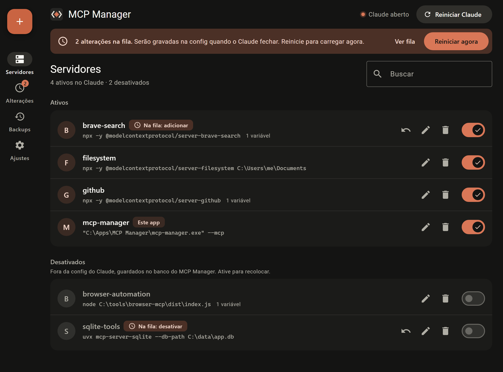

<p align="center">
  
</p>

<h1 align="center">MCP Manager</h1>

<p align="center">
  <b>Gerenciador dos servidores MCP do Claude Desktop.</b>
</p>

<p align="center">
  <a href="../../releases/latest"></a>
  <a href="../../releases"></a>
  <a href="LICENSE"></a>
  
  
</p>

<p align="center">
  <a href="README.md">English</a> · <b>Português (Brasil)</b>
</p>

<p align="center">
  
</p>

---

MCP Manager é um app gratuito e de código aberto para Windows que adiciona, edita, desativa e remove
os servidores MCP do Claude Desktop, por uma janela ou pelo próprio chat do Claude. Toda alteração
feita com o Claude aberto espera numa fila e é gravada em `claude_desktop_config.json` quando ele
fecha; o botão **Reiniciar Claude** fecha o app, aplica a fila e o abre de novo. Ele também guarda os
servidores desativados para reativar depois, faz backup da config antes de cada gravação, fica na
bandeja, a um clique, e se atualiza sozinho.

Roda no Windows (x64), com a interface em português do Brasil e em inglês, e funciona com as duas
formas de instalação do Claude Desktop: o pacote MSIX e o instalador antigo em
`%LOCALAPPDATA%\AnthropicClaude`. É para quem configura servidores MCP no Claude Desktop e não quer
editar o JSON à mão nem acertar o momento de reiniciar o app. Mexe só na config do Claude Desktop:
o `~/.claude.json` do Claude Code no terminal fica de fora, assim como servidores remotos só com URL,
que essa config não aceita.

## Destaques

- **Nada muda com o Claude aberto.** O Claude Desktop reescreve a própria config enquanto roda, então
  toda alteração feita com ele aberto entra numa fila. Ela é gravada quando o último processo do Claude
  fecha; **Reiniciar Claude** fecha o app, aplica a fila e o abre de novo.
- **Desativar não apaga.** O servidor desativado sai da config e fica guardado no banco do MCP Manager
  com o comando, os argumentos, as variáveis de ambiente e qualquer outro campo. Ativar devolve a mesma
  entrada.
- **Também pelo chat.** O app é um servidor MCP: registrado com um clique, deixa o Claude listar,
  adicionar, editar, desativar e remover servidores. Por ele, os valores das variáveis chegam ao chat
  como `***`, a não ser que o agente peça por eles.
- **Backup antes de cada gravação.** Uma cópia de `claude_desktop_config.json` é feita antes de gravar
  e ao abrir o app, quando a config mudou; ficam as 100 mais recentes, e qualquer uma pode ser
  restaurada. Só `mcpServers` é alterado: `preferences` e as outras chaves voltam como estavam.
- **Acha a config pelo executável do Claude.** O caminho sai do `Claude.exe` em execução ou do pacote
  registrado no Windows: `%LOCALAPPDATA%\Claude-Data\<pacote>\` no MSIX, `%APPDATA%\Claude\` na
  instalação antiga.
- **Se atualiza sozinho, e nada mais vai à internet.** A tela inicial mostra as versões ainda não
  instaladas; um clique no Changelog baixa o exe novo, confere a assinatura e reinicia o app, mesmo
  com o Claude rodando o MCP dele. Essa consulta à última versão publicada neste repositório, que dá para desligar
  em Ajustes, é a única requisição de rede do MCP Manager.

---

## Instalação

Baixe o `mcp-manager.exe` da [última versão](../../releases/latest), ponha numa pasta só dele, como
`%LOCALAPPDATA%\Programs\MCP Manager\`, e abra com dois cliques. Não há instalador: o exe é o app
inteiro, e as próximas versões o substituem no lugar pela tela de Changelog. Na primeira vez, o
cartão **Primeiros passos**, em Servidores, registra o MCP do app no Claude, liga o início com o
Windows e cria o atalho no Menu Iniciar.

> [!IMPORTANT]
> O exe não tem assinatura de código: o Windows pode mostrar "O Windows protegeu o computador" na
> primeira vez. Confira o download com o `SHA256SUMS.txt` da página da versão e escolha **Mais
> informações** e **Executar assim mesmo**.

> [!NOTE]
> O caminho do exe fica gravado na config do Claude quando o MCP do app é registrado, e na entrada de
> início com o Windows, então escolha a pasta antes de abrir pela primeira vez. Se mover o arquivo
> depois, Ajustes mostra "Aponta para outro executável" com o botão **Atualizar o caminho**; desligue
> e ligue **Iniciar com o Windows** para corrigir a outra entrada.

<details>
<summary><b>Conferir o download</b> — compare o exe com o hash publicado</summary>

```powershell
(Get-FileHash .\mcp-manager.exe -Algorithm SHA256).Hash
```

O resultado tem de bater com a linha do `mcp-manager.exe` no `SHA256SUMS.txt`, sem diferenciar
maiúsculas. A atualização pelo app vai além: confere a assinatura do exe novo com a chave embutida no
app e recusa um arquivo assinado para qualquer outra versão.

</details>

<details>
<summary><b>Compilar a partir do código</b> — pré-requisitos, desenvolvimento e variáveis de teste</summary>

É preciso Windows x64 com o
[WebView2 Runtime](https://developer.microsoft.com/microsoft-edge/webview2/) (já vem no Windows 11 e
no Windows 10 atualizado), Rust 1.89 ou mais novo com o toolchain MSVC e o Visual Studio Build Tools,
e Node.js 20.19+, 22.12+ ou 24+.

```powershell
npm install
npm run app:build
npm run app:dev
npm run dev
npm run check
cd src-tauri; cargo test
```

`npm run app:build` gera `src-tauri\target\release\mcp-manager.exe`. `npm run app:dev` abre o app com
hot reload. `npm run dev` serve só a interface no navegador, em `http://localhost:1420`, com dados de
exemplo; `?hero` abre o estado do print acima, `?lang=en-US` ou `?lang=pt-BR` escolhe o idioma, e
`?noupdate` esconde a atualização de exemplo.

| Variável | Efeito |
|---|---|
| `MCP_MANAGER_HOME` | Pasta de dados no lugar de `%USERPROFILE%\.mcp-manager` |
| `MCP_MANAGER_CONFIG` | Config usada no lugar da detectada |
| `MCP_MANAGER_FAKE_CLAUDE` | `1` finge o Claude aberto, `0` fechado |
| `MCP_MANAGER_NO_WATCHER` | Não inicia o vigia nem o app na bandeja |
| `MCP_MANAGER_UPDATE_FEED` | URL do feed de atualização no lugar do `latest.json` da última versão |

</details>

<details>
<summary><b>Publicar uma versão</b> — changelog, número da versão, tag e o workflow de release</summary>

Toda mudança acrescenta suas entradas em `## [Unreleased]` no [CHANGELOG.md](CHANGELOG.md) e em
`locales/changelog/pt-BR.md`. Para publicar:

```powershell
powershell -ExecutionPolicy Bypass -File tools\version.ps1 -Version 0.2.0 -Push
```

O script põe a versão no `package.json`, `package-lock.json`, `tauri.conf.json`, `Cargo.toml` e
`Cargo.lock`, transforma Unreleased em `[0.2.0]` com a data do dia nos dois changelogs, commita, cria
a tag `v0.2.0` e envia. A tag dispara o `.github/workflows/release.yml`, que testa, compila, assina o
exe com os secrets `TAURI_SIGNING_PRIVATE_KEY` e `TAURI_SIGNING_PRIVATE_KEY_PASSWORD` do repositório
e cria o rascunho da versão com o exe, a assinatura, o `latest.json` e o `SHA256SUMS.txt`. Os apps
instalados enxergam a versão quando o rascunho é publicado.

</details>

---

## A janela

Abra pelo ícone da bandeja ou pelo atalho do Menu Iniciar. O botão **+** adiciona um servidor. A
janela desenha a própria barra de título: ela mostra se o Claude está aberto e, quando há alterações
na fila, o botão **Reiniciar Claude**, com uma faixa logo abaixo explicando a fila.

| Tela | O que faz |
|---|---|
| **Servidores** | Os servidores ativos e os desativados, com a chave que liga e desliga cada um, editar, remover e desfazer a última alteração na fila. O editor aceita o JSON colado de um README e preenche comando, argumentos e variáveis. Quando há versão nova, um cartão no topo mostra as versões novas e suas datas, com **Ver changelog**. |
| **Alterações** | A fila, com cancelar uma alteração ou descartar todas, e o histórico do que já foi aplicado, com as que falharam e o motivo. |
| **Backups** | As cópias da config, com data e número de servidores. **Ver** lista os servidores de uma cópia e **Restaurar** põe a lista dela na fila. |
| **Changelog** | As notas de todas as versões, da mais nova para a mais antiga, com as ainda não instaladas no topo, **Procurar atualizações** e a própria atualização. |
| **Ajustes** | O início com o Windows e com o Claude, a busca de atualizações, o atalho no Menu Iniciar, o idioma (automático, português ou inglês), o registro do MCP do app, o executável e o pacote do Claude encontrados, o caminho da config (ou outro, escolhido por você) e a pasta de dados. |

## A bandeja

O ícone dos colchetes fica na área de notificação. O clique abre a janela; o menu tem **Abrir MCP
Manager**, **Reiniciar o Claude e aplicar a fila** e **Sair**, e a dica do ícone diz quantas
alterações estão na fila. Fechar a janela só a esconde. O app vai para a bandeja sozinho, sem janela,
quando o Windows inicia (se ligado em Ajustes) e quando o Claude inicia o MCP dele e o app ainda não
está rodando.

## O MCP do app

**Ajustes › MCP do próprio app › Adicionar ao Claude** grava o próprio executável na config do Claude,
com `--mcp`:

```json
{
  "mcpServers": {
    "mcp-manager": {
      "command": "C:\\Users\\voce\\AppData\\Local\\Programs\\MCP Manager\\mcp-manager.exe",
      "args": ["--mcp"]
    }
  }
}
```

| Ferramenta | O que faz |
|---|---|
| `list_servers` | Lista os servidores ativos, os desativados e a fila, com os nomes das variáveis, sem os valores. |
| `get_server` | Mostra a entrada inteira de um servidor; os valores das variáveis só com `reveal_env`. |
| `add_server` | Adiciona um servidor com comando, argumentos, variáveis e outros campos. |
| `update_server` | Muda só os campos dados: `env` soma variáveis às que existem, `remove_env` apaga algumas, `rename` troca o nome. |
| `remove_server` | Remove o servidor da config ou, se estiver desativado, do banco do MCP Manager. |
| `disable_server` | Tira o servidor da config e o guarda no banco, para ativar depois. |
| `enable_server` | Devolve um servidor desativado à config. |
| `list_changes` | A fila e as últimas alterações aplicadas. |
| `cancel_change` | Cancela uma alteração da fila pelo número, ou todas. |
| `open_manager` | Abre a janela do MCP Manager. |

Com o Claude aberto, toda alteração volta como `queued`, com o aviso de que o Claude precisa ser
reiniciado. Um vigia sem janela (`mcp-manager.exe --watch`) espera o Claude fechar, grava a fila e
termina. Depois de uma atualização, o MCP dentro do Claude segue na versão anterior até o Claude
reiniciar.

## Onde ficam os dados

| Caminho | O que é |
|---|---|
| `%USERPROFILE%\.mcp-manager\mcp-manager.db` | A fila, os servidores desativados, o histórico e os ajustes. Os desativados só existem aqui: apagar o arquivo os perde. |
| `%USERPROFILE%\.mcp-manager\backups\` | As cópias de `claude_desktop_config.json`. |
| `%USERPROFILE%\.mcp-manager\mcp-manager.log` | O registro do vigia, de cada gravação na config e de cada atualização. |
| `mcp-manager.old.exe`, ao lado do exe | A versão anterior depois de uma atualização, mantida enquanto o MCP do Claude ainda a usa; a próxima abertura a apaga. |
| `%LOCALAPPDATA%\com.mcpmanager.desktop\` | Os arquivos da janela (WebView2). |
| `HKCU\Software\Microsoft\Windows\CurrentVersion\Run`, valor `MCP Manager` | O início com o Windows, quando ligado. |
| `%APPDATA%\Microsoft\Windows\Start Menu\Programs\MCP Manager.lnk` | O atalho do Menu Iniciar, quando criado. |

**Ajustes › Dados do MCP Manager** abre a pasta. Para tirar o app do PC: remova o servidor
`mcp-manager` em Servidores, desligue **Iniciar com o Windows**, saia pela bandeja e apague o
executável, as duas pastas e o atalho.

## Licença

O MCP Manager é distribuído sob a [licença MIT](LICENSE). Os ícones da interface vêm dos Material
Icons do Google, sob a Apache License 2.0.
